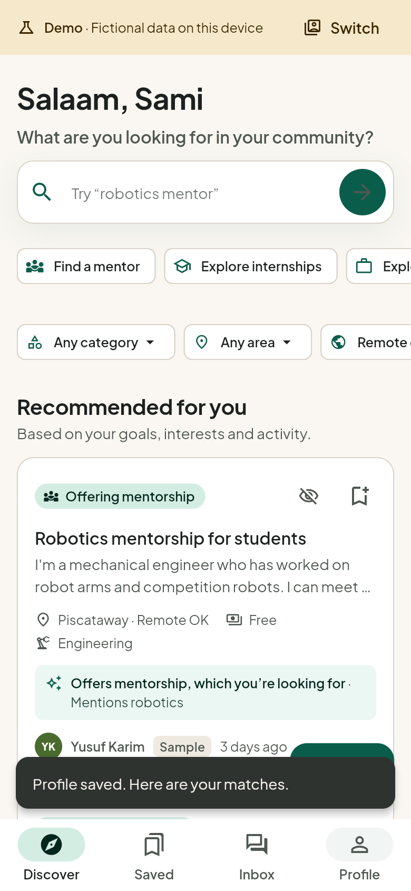
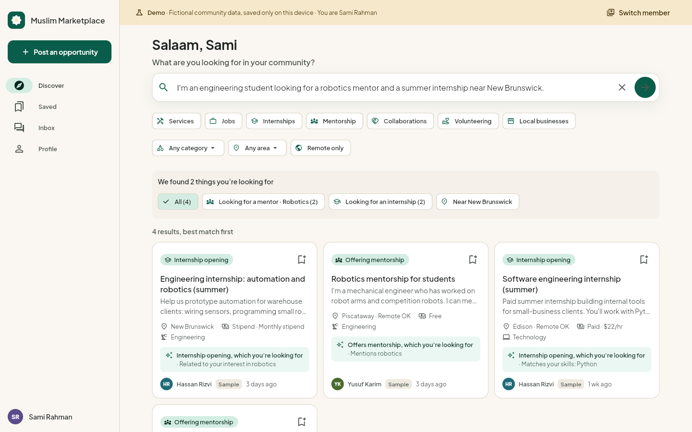

# Muslim Marketplace

A Flutter app that helps Muslims in Central Jersey discover services, jobs, internships, mentors, collaborators, volunteering and local businesses within their community. Members describe what they offer and what they need in plain words, review what the app picked up, and get listings ranked for them with the reasons each one fits. Discover centers on a large voice-search button and gently rotating prompts, with an optional typing field and no filter controls. Members can save listings, send a connection request, and continue privately in a conversation once it is accepted.

One codebase runs on the web, iOS and Android. It has two clearly separated modes:

- **Demo mode** runs with no account, keys or network. It uses fictional members and listings, saves to the device, and lets you switch between fictional members to try both sides of a request.
- **Connected mode** uses real accounts and shared data through [Supabase](https://supabase.com), with ownership and conversation privacy enforced by the database.

| Phone | Desktop |
| --- | --- |
|  |  |

More screenshots are in [docs/screenshots](docs/screenshots).

## Quick start: the demo

You need the [Flutter SDK](https://docs.flutter.dev/get-started/install) 3.44 or newer (Dart 3.12) and Chrome.

```bash
git clone <this repository> muslim-marketplace
```

```bash
cd muslim-marketplace
```

```bash
flutter pub get
```

```bash
flutter run -d chrome
```

Then choose **Try the demo** to set up a new member, or **Explore as a sample member** to start as Amina, a fictional engineering student.

To serve an optimized build instead:

```bash
flutter build web --release
```

```bash
python3 -m http.server 8080 --directory build/web
```

and open <http://localhost:8080>.

### Demo members, switching and reset

All demo people, groups, businesses and messages are fictional and marked **Sample**. Use **Switch member** in the yellow demo banner (or Profile → Privacy and settings → Switch demo member) to act as anyone below. Members you create during onboarding appear in the same list.

| Member | Useful for |
| --- | --- |
| Amina Rahman | Engineering student seeking a robotics mentor and an internship; has an accepted conversation with Yusuf |
| Yusuf Karim | Mechanical engineer offering robotics mentorship; receives requests |
| Zaid Mansour | High school senior seeking tutoring, an internship and a mentor (not in the directory) |
| Fatima Siddiqui | Math and physics tutor; has a pending request from Zaid |
| Sarah Ahmed | Accountant offering services and mentorship, hiring an assistant |
| Bilal Chaudhry | Developer offering websites and career mentorship |
| Hana Ali | Coordinates a youth robotics group recruiting volunteer mentors |
| Omar Haddad, Ibrahim Patel, Maryam Hussain, Khadija Noor, Hassan Rizvi | Local businesses, trades, design, career coaching and an IT firm |

**Reset:** Profile → Privacy and settings → **Reset demo data** restores the original sample data. It only touches demo data on this device. **Leave the demo** returns to the welcome screen and keeps your demo data.

Demo data is stored in the browser's local storage (or the device's app preferences), so it survives refreshes and restarts.

## Five-minute walkthrough

1. **Welcome (20 s).** Open the app. The first screen explains the idea in two sentences. Choose **Try the demo**.
2. **Describe yourself (60 s).** Enter a name. For "offer" type *I can tutor high school math*. For "looking for" type *A robotics mentor and a summer engineering internship*. Add interests *robotics, soccer* and area *New Brunswick*. Choose **Review**.
3. **Review (30 s).** The app shows what it picked up from your own words: goals such as *Looking for a mentor · Robotics* and *Looking for an internship · Engineering*, skills and interests, area. Nothing is invented; edit anything. The member directory is off until you turn it on. **Save and see matches**.
4. **Recommendations (40 s).** The home page ranks listings for you, each with a reason, for example *Offers mentorship, which you're looking for · Mentions robotics*. A group that needs a volunteer mentor and another student seeking a mentor are not shown as matches for you.
5. **Search in your own words (40 s).** Tap the large microphone on Discover and say *I'm an engineering student looking for a robotics mentor and a summer internship near New Brunswick.* Or open the typing option and enter the same request. The app shows what it understood and ranks matches for the whole request together, without filter controls.
6. **Inspect and save (30 s).** Open *Robotics mentorship for students*. "Why this might fit you" lists the reasons, and "How this was ranked" shows each factor. Choose **Save for later**, then **Request to connect** and **Send request**.
7. **The other side (50 s).** Choose **Switch member → Yusuf Karim**. Open **Inbox → Requests**, **Accept**, and send a message. Switch back to your member and reply in **Inbox → Messages**.
8. **Post (30 s).** Choose **Post an opportunity**, pick a type and whether you're offering or looking, fill in the short form and publish. Edit, pause, close or delete it from the listing page.

## Connected mode (real accounts)

Connected mode needs a Supabase project: a local one (below) or a hosted one.

### Local backend

Requirements: the [Supabase CLI](https://supabase.com/docs/guides/local-development/cli/getting-started) and a Docker-compatible runtime (Docker Desktop, or [Colima](https://github.com/abiosoft/colima) on macOS).

```bash
supabase start
```

```bash
supabase db reset
```

`db reset` applies `supabase/migrations/` and loads `supabase/seed.sql` (the same fictional data as the demo, with local test accounts). Then create your local config from the example:

```bash
cp config/local.example.json config/local.json
```

Run `supabase status` and paste the **API URL** and **Publishable key** into `config/local.json`. Then run the app:

```bash
flutter run -d chrome --dart-define-from-file=config/local.json
```

Choose **Create an account** (local email confirmation is off) or **Sign in** with a seeded account. Seeded accounts use the member's first name at `example.test`, for example `amina@example.test`, `yusuf@example.test` or `zaid@example.test`, with the local-only password `community-demo-2026`. These are fictional development accounts; never load `seed.sql` into a production project.

To try two people at once, sign in as one member in a normal Chrome window and another in a separate Chrome profile or a different browser (sessions are stored per browser profile).

### Hosted Supabase project

```bash
supabase link --project-ref <your-project-ref>
```

```bash
supabase db push
```

Put the project URL and its publishable (or anon) key in `config/local.json` (or pass them with `--dart-define`). In the Supabase dashboard, set the Auth site URL to where you host the web build. Email confirmation is on by default for hosted projects; the app tells new members to confirm their email before signing in. Do not push the seed file to a project with real members.

### Configuration

| Setting | Where | Purpose |
| --- | --- | --- |
| `SUPABASE_URL` | `config/local.json` or `--dart-define` | Project API URL. Without it, accounts are unavailable and the app runs the demo only. |
| `SUPABASE_PUBLISHABLE_KEY` (or `SUPABASE_ANON_KEY`) | same | Public client key. Safe to ship; access is controlled by row-level security. |
| `AI_EXTRACTION` | same | `true` to ask the `extract-profile` function for onboarding suggestions in connected mode. |
| `ANTHROPIC_API_KEY` | Supabase function secret only | Never in the app or this repository. |
| `EXTRACTION_MODEL` | Supabase function secret (optional) | Defaults to `claude-opus-5-5`. |
| `VOICE_SEARCH_URL` | App config or `--dart-define` | Public endpoint for voice transcription. No AI key is included in the app. |
| `GEMINI_API_KEY` | Voice server environment only | Gemini credential; never pass it to a Flutter build. |
| `GEMINI_MODEL` | Voice server environment (optional) | Transcription model; defaults to `gemini-3.8-flash`. |

`config/*.json` (except the example), `.env` files and `supabase/functions/.env` are ignored by git. No secrets are committed.

### What the database enforces

- Every table has row-level security. Members read and change only their own profile settings, saved listings, activity and listings.
- Listings: anyone signed in sees active listings; owners see their own in any status. Only owners edit, pause, close or delete. Status changes follow `active ↔ paused → closed` (closed is final), enforced by a trigger.
- Connection requests can only be created, answered or withdrawn through database functions that check who you are, that the listing is active and belongs to the recipient, and that the transition is allowed. Direct inserts and updates are refused.
- Conversations are created only when a request is accepted and are readable only by their two participants; messages can only be written by a participant as themselves.
- Directory details are readable only for members who opted in.

The migration is in [`supabase/migrations`](supabase/migrations); the multi-client tests in [`test/connected`](test/connected) exercise each rule against a real backend.

### Optional AI extraction

Onboarding answers can be interpreted by Claude through a Supabase Edge Function, so the API key stays on the server:

```bash
supabase secrets set ANTHROPIC_API_KEY=<your key>
```

```bash
supabase functions deploy extract-profile
```

Then set `"AI_EXTRACTION": "true"` in `config/local.json`. For local testing, put `ANTHROPIC_API_KEY=...` in `supabase/functions/.env` and run `supabase functions serve --env-file supabase/functions/.env`.

The app treats the function's answer as untrusted: it checks the shape, keeps only skills, interests, subjects and places whose words appear in the member's answers, and merges the result with the built-in parser. If the function is not configured, times out (8 seconds), returns malformed data, declines, or fails, members still get suggestions from the built-in parser and can edit everything. Typed search never calls the AI.

The built-in parser recognises role phrases ("looking for", "I can", "hiring"), opportunity words (mentor, internship, volunteers, tutor and others), about 70 skills and subjects, 20 Central Jersey town names and remote preferences. It does not understand arbitrary phrasing, synonyms outside its vocabulary, or negation; anything it misses can be added on the review screen.

### Voice search through the server

Discover centers on a large microphone with fading prompts. Tap it and say what you need, such as *"I need a robotics mentor near New Brunswick"*. Listening stops when you pause, tap again, or reach 15 seconds. The app sends the recording to your voice server, which calls Gemini and returns only the transcript. The existing matcher ranks the results for the whole request. The app contains no Gemini key or model configuration. Typing remains available, and prompts stay still with reduced motion enabled.

Set `VOICE_SEARCH_URL` to the full transcription endpoint in a **public-only app config**. Without an endpoint the microphone is unavailable and typing still works. In debug builds, Privacy and settings reports `voiceSearch=true` when an endpoint is configured.

For a local iPhone development run, the relay can read the existing ignored `config/local.json` **on the Mac only** (or use `GEMINI_API_KEY` and `GEMINI_MODEL` from the server environment):

```bash
python3 tool/voice_search_server.py --config config/local.json --host <Mac-private-LAN-IP> --port 8765
```

The relay accepts only loopback/private LAN addresses and peers, bounds audio requests, and limits concurrency and request rates. It is a development service, not a public hosting server. Keep the Mac running and the iPhone on the same trusted Wi-Fi. Create a separate ignored `config/iphone.json` with only the Supabase public connection settings, a Mac-reachable `SUPABASE_URL`, and `VOICE_SEARCH_URL`, for example `http://<Mac-private-LAN-IP>:8765/transcribe-search`. Never copy `GEMINI_API_KEY` into that build config.

```bash
python3 tool/run_iphone.py --device <iPhone-device-id> --config config/iphone.json
```

The iPhone installer builds with only public config, verifies that the exact voice endpoint is present in the compiled app, then installs and launches that verified copy. It stops before installation if voice configuration was omitted or another build replaced it.

For a hosted backend, deploy `supabase/functions/transcribe-search` and store the Gemini key as a Supabase function secret. The hosted endpoint requires a signed-in member and enforces audio and rate limits; the app sends the current member's access token. Point `VOICE_SEARCH_URL` to `https://<project-ref>.supabase.co/functions/v1/transcribe-search`. The local demo does not provide hosted account credentials.

Recordings are 16 kHz mono PCM WAV. The service accepts `POST {"audio":"<base64 WAV>"}` and returns `{"transcript":"..."}`. Only a recording started by the member is sent; silence and steady noise are rejected in the app before transmission. The server asks Gemini to transcribe without inventing words. The app validates the response, trims it to 300 characters, and uses it only as search text. Permission, network and service failures preserve the previous search.

Microphone permission is declared on iOS, macOS and Android. iOS also declares local network access for a local development server; allow it when testing with the Mac relay. Public production endpoints should use HTTPS. Browsers require an HTTPS page or localhost for microphone access.

## How matching works

Listings have a **type** (service, job, internship, mentorship, collaboration, volunteering, local business), a **direction** (the poster offers it or is looking for it) and a **category** (subject). A goal such as "looking for a mentor" only matches listings that *offer* mentorship; a group seeking a volunteer mentor or another student seeking a mentor is not a match.

Eligible listings are ranked with configurable starting weights: goal and listing type 30%, skills and interests 25%, description relevance 25%, location 10%, recency 5%, your activity 5%. Missing signals are left out rather than guessed, ties break by newest then id, weak or unrelated listings are dropped, and an empty result says so instead of inventing anything. Every reason shown comes from actual profile, request and listing fields. Saves, connection requests, "show less like this" and (a little) viewing adjust ranking; you can turn this off or reset it in settings.

Full details, including how business entries fit the model and the status rules, are in [docs/08-implementation-decisions.md](docs/08-implementation-decisions.md).

## Project structure

```
lib/
  main.dart                 Entry point
  src/
    bootstrap.dart          Builds the app; connected mode only when configured
    domain/                 Typed models, taxonomy, areas, status rules
    matching/               Parser, AI-output validation, ranking, preferences
    voice/                  Microphone recording and server-backed voice transcription
    data/                   Repository interfaces, demo backend, Supabase backend, seed data
    state/                  Riverpod providers and controllers
    features/               Screens (welcome, auth, onboarding, home, listing, saved, inbox, profile, members)
    routing/                go_router configuration and the adaptive shell
    ui/                     Theme, design tokens, shared widgets
supabase/
  migrations/               Schema, row-level security, functions
  seed.sql                  Generated fictional data (tool/generate_seed_sql.dart)
  functions/extract-profile Optional AI extraction (Deno, Anthropic SDK)
  functions/transcribe-search Server-side Gemini voice transcription
test/                       Unit, widget and connected-backend tests
integration_test/           End-to-end journeys
docs/                       Planning documents (01–07), decisions (08), screenshots
```

After changing seed content in `lib/src/data/seed/seed_data.dart`, regenerate the SQL with `dart run tool/generate_seed_sql.dart > supabase/seed.sql`.

## Tests and checks

```bash
dart format --output=none --set-exit-if-changed lib test integration_test tool
```

```bash
flutter analyze
```

```bash
flutter test
```

`flutter test` runs the unit and widget tests; the connected tests skip themselves when no backend is configured. With the local backend running:

```bash
flutter test test/connected --dart-define-from-file=config/local.json
```

End-to-end journeys (onboarding → search → save → restart; post → edit → close; request → switch → accept → message → restart; conversation privacy; directory visibility) on the macOS desktop target:

```bash
flutter test integration_test/demo_journeys_test.dart -d macos
```

The multi-user journey through the interface against the backend (three new accounts: owner, requester and an unrelated member):

```bash
flutter test integration_test/connected_journey_test.dart -d macos --dart-define-from-file=config/local.json
```

In a browser, start a [ChromeDriver](https://googlechromelabs.github.io/chrome-for-testing/) that matches your Chrome on port 4444, then:

```bash
flutter drive --driver=test_driver/integration_test.dart --target=integration_test/demo_journeys_test.dart -d web-server
```

Release builds:

```bash
flutter build web --release
```

```bash
flutter build ios --simulator
```

```bash
flutter build apk
```

## Platform status

Verified on October 24, 2026 with Flutter 3.44.4, Dart 3.12.2, Xcode 26.2 and Chrome 155:

| Platform | Status |
| --- | --- |
| Web (Chrome) | Release build succeeds. The five demo journeys pass in Chrome through ChromeDriver. Inspected at 390, 820 and 1440 pixels wide. |
| macOS desktop | The five demo journeys and the connected multi-user journey pass. Used as the integration-test host. |
| iOS | Simulator build succeeds; the five demo journeys pass on an iPad Pro (12.9-inch, 6th generation) simulator running iOS 17.4. Not run on an iPhone simulator or a physical device. |
| Android | Project and source included but not built or run: this machine has no Android SDK, and building needs the Android SDK plus JDK 17 or newer. |

## Limitations

- Demo data lives on one device and is not shared. Two people testing together need connected mode.
- The built-in parser is rule-based; see its scope above. AI extraction is optional and was not exercised against the live model in this repository's verification (no API key was available).
- Ranking runs in the app over all visible listings, which suits hundreds of listings, not many thousands. Moving ranking into the database is the next step for scale.
- Messaging is text only: no attachments, read receipts, push notifications, blocking or reporting yet.
- LinkedIn is a link only; nothing is imported. Masjid affiliation is self-reported and never verified.
- No moderation or organization administration tools, payments, or social graph.
- The interface is English only and uses a light theme.
- Voice search needs a reachable transcription server. The Mac relay is for local development on the same Wi-Fi; a hosted deployment needs the authenticated Edge Function and server-side Gemini secret. Microphone permission must be allowed on the device.

## Planning documents

The original planning record is preserved in `docs/`:

| Document | What it contains |
| --- | --- |
| [Product brief](docs/01-product-brief.md) | The problem, users, stated requirements and directions |
| [MVP and user flows](docs/02-mvp-and-user-flows.md) | Priorities, journeys, acceptance criteria |
| [Matching and personalization](docs/03-matching-and-personalization.md) | Language understanding, ranking, explanations |
| [Data and trust](docs/04-data-and-trust.md) | Entities, listing semantics, privacy, affiliation |
| [Hackathon plan](docs/05-hackathon-plan.md) | Roles, validation, demonstration (event details unverified) |
| [Decisions and open questions](docs/06-decisions-and-open-questions.md) | The questions as they stood before implementation |
| [Future build prompts](docs/07-future-build-prompts.md) | Historical prompts, kept for reference |
| [Implementation decisions](docs/08-implementation-decisions.md) | What was built and why |
| [Source chat archive](docs/00-source-chat.md) | The original conversation |

No interviews, partnerships, real listings or verified providers are claimed anywhere in the app or documents.


Copyright (c) 2026 Hamza Memon and Hamza Ahmad. All rights reserved.

This project is proprietary. No permission is granted
to use, reproduce, modify, distribute, or commercially
exploit the original source code without prior
written authorization from the copyright owner.
